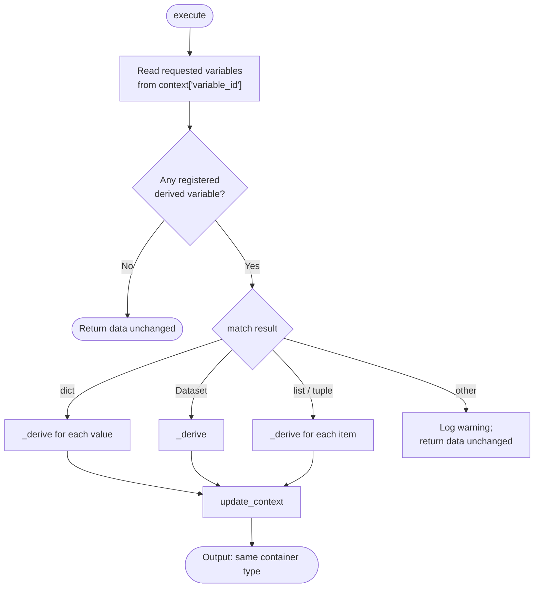

# Processor: DeriveVariables

**Registry key:** `derive_variables` &nbsp;|&nbsp; **Priority:** 3 &nbsp;|&nbsp; **Category:** Derived Variables

Internal processor that calculates registered derived variables (for example `wind_speed_10m` or `diurnal_temperature_range_loca`) from their dependency fields. Validators add it automatically when `variable_id` names a registered derived variable. You do not put it in `.processes({...})`.

It runs after `clip` (priority 2), so each derived function receives only the clipped grid. It runs before `convert_units`, `warming_level`, and `concat`, so those processors receive the derived fields.

## Algorithm



For each Dataset, `_derive` does these steps for each requested derived variable, in request order:

1. Check that all fields in `depends_on` are present. If a field is missing, raise `ValueError`.
2. Call the registered function on a shallow copy of the Dataset. Thus, cleanup in one function cannot remove a field that a later function needs.
3. Check that the function returned its registered output name. If not, raise `ValueError`.
4. Add the new fields to the Dataset. Fields that already exist are not replaced, so a function cannot change its input fields.
5. Copy spatial metadata (`grid_mapping` or a rioxarray CRS) from a dependency if the output has none.

The output contains the requested variables in request order. Dependencies follow them only when their function was registered with `drop_dependencies=False`. All other dependency fields are removed.

## Behavior notes

- **Clipped grid only.** A function that uses nearby cells, for example a spatial gradient, sees only the clipped extent.
- **Native units.** `convert_units` runs later, so derived functions receive the catalog units (for example, K for temperature).
- **Full time series.** `warming_level` runs later, so time shifts such as `shift(time=...)` use the complete time series.
- **One dataset per simulation.** `concat` runs later, so a dict of datasets is processed key by key.
- **Point clips.** A Dataset with two or more dependency fields uses the common-cell point selection in `clip`. If the nearest cell is NaN, the derived output is NaN. See [Clip](clip.md#mode-3-single-point-closest-valid-gridcell).
- A `DataArray` value is returned unchanged.

## Parameters

| Field | Type | Default | Notes |
|-------|------|---------|-------|
| `value` | `UNSET` | `UNSET` | Not used. The validator accepts only `UNSET`. The processor reads the requested variables from `context["variable_id"]` and the functions from the derived-variable registry. |

## Example (implicit)

```python
from climakitae.new_core.user_interface import ClimateData

data = (ClimateData()
    .catalog("cadcat")
    .activity_id("LOCA2")
    .institution_id("UCSD")
    .source_id("ACCESS-CM2")
    .experiment_id("historical")
    .table_id("day")
    .grid_label("d03")
    .variable_id("diurnal_temperature_range_loca")
    .processes({"clip": "Los Angeles"})
    .get())

# Retrieval opens only tasmax and tasmin. clip (2) subsets them, then
# derive_variables (3) calculates diurnal_temperature_range_loca and
# removes tasmax and tasmin.
print(list(data.data_vars))
```

`ClimateData().show_processors()` lists `derive_variables`. `ClimateData().show_derived_variables()` lists the registered derived variables.

## Code References

| Method | Link to Code | Purpose |
|--------|-------|----------|
| `execute` | [View on Github](https://github.com/search?q=repo%3Acal-adapt%2Fclimakitae+symbol%3Aexecute+path%3Aderive_variables.py&type=code) | Find requested derived variables; route by result type |
| `_derive` | [View on Github](https://github.com/search?q=repo%3Acal-adapt%2Fclimakitae+symbol%3A_derive+path%3Aderive_variables.py&type=code) | Check dependencies, call functions, select output fields |
| `_ensure_spatial_metadata` | [View on Github](https://github.com/search?q=repo%3Acal-adapt%2Fclimakitae+symbol%3A_ensure_spatial_metadata+path%3Aderive_variables.py&type=code) | Copy CRS metadata from a dependency |
| `update_context` | [View on Github](https://github.com/search?q=repo%3Acal-adapt%2Fclimakitae+symbol%3Aupdate_context+path%3Aderive_variables.py&type=code) | Record the calculated variables in `context["new_attrs"]` |
| `requested_derived_variables` | [View on Github](https://github.com/search?q=repo%3Acal-adapt%2Fclimakitae+symbol%3Arequested_derived_variables+path%3Aderive_variables.py&type=code) | Helper used by validators to decide when to add this processor |

## See also

- [Processor index](index.md)
- [Clip](clip.md)
- [Derived variables how-to](../howto/derived-variables.md)
- [`climakitae/new_core/processors/derive_variables.py`](https://github.com/cal-adapt/climakitae/blob/main/climakitae/new_core/processors/derive_variables.py)
